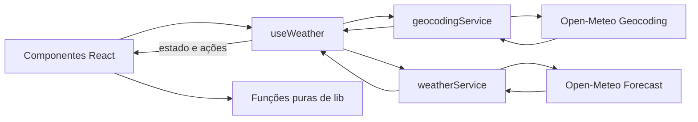
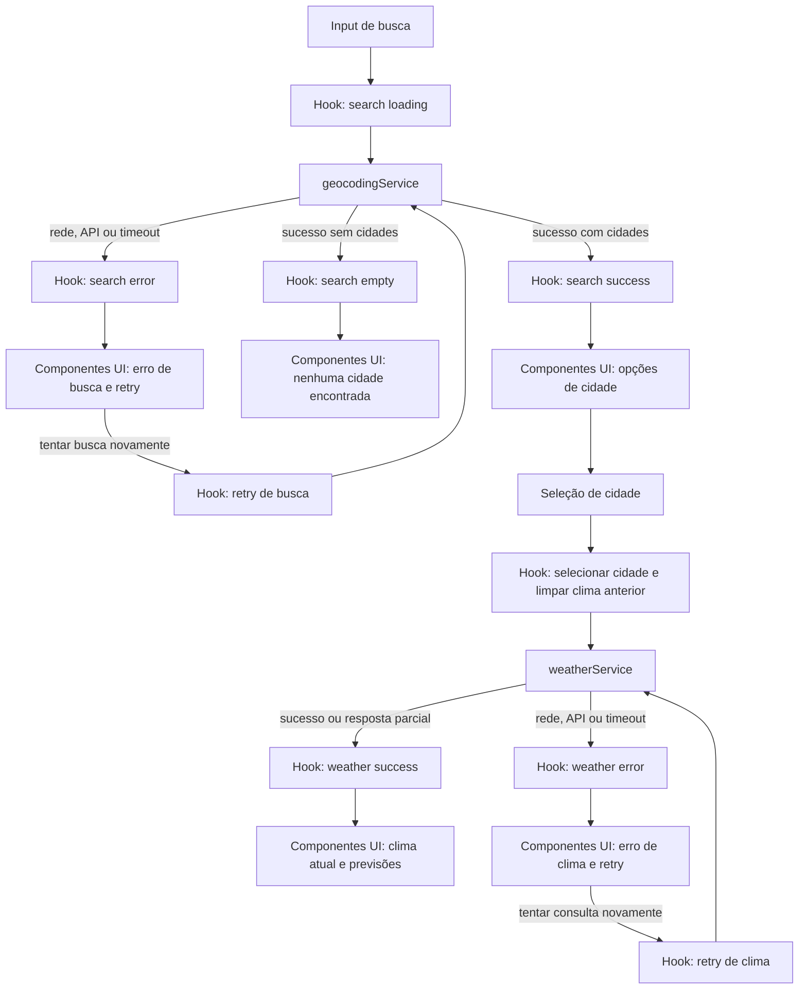

# Plano Técnico — Aplicação de Previsão do Tempo

Fonte da verdade: [specs/weather-app-spec.md](../specs/weather-app-spec.md). Este plano define decisões e contratos para a implementação; não altera o escopo aprovado.

## Architecture

SPA React com fluxo unidirecional e quatro responsabilidades explícitas: apresentação (`components/`), orquestração e estado (`hooks/`), acesso a dados (`services/`) e transformações puras (`lib/`). Os contratos compartilhados ficam em `types/`. Na primeira versão, o navegador consulta diretamente as APIs públicas da Open-Meteo; não há servidor de aplicação, cache, autenticação ou persistência.



- **Apresentação (`components/`):** formulário, resultados, condições atuais, previsões, alternador de unidade e mensagens. Recebem dados e callbacks por props; não fazem chamadas HTTP nem controlam a seleção da cidade.
- **Orquestração e estado (`hooks/`):** `useWeather` coordena busca, seleção, consulta, retry e unidade. Mantém busca e clima em estados distintos, cancela ou ignora respostas obsoletas e limpa os dados anteriores ao selecionar outra cidade.
- **Acesso a dados (`services/`):** `geocodingService` e `weatherService` encapsulam URLs, `fetch`, timeout, tratamento de falhas e mapeamento das respostas externas para os contratos internos. Componentes e hooks não dependem da estrutura JSON da Open-Meteo.
- **Funções puras (`lib/`):** conversão e arredondamento de temperatura, formatação de datas/horas no fuso da cidade e mapeamento de códigos WMO para descrição e ícone. Não fazem I/O nem mantêm estado.
- **Contratos (`types/`):** tipos compartilhados para cidade e dados meteorológicos; valores ausentes são representados explicitamente para a interface não confundi-los com zero.
- **Testabilidade:** componentes podem ser verificados com Testing Library e serviços simulados; o hook pode ser testado com serviços mockados; serviços usam `fetch` mockado e fixtures; funções de `lib/` permitem testes unitários determinísticos sem React ou rede.
- **Segurança e privacidade:** HTTPS; entrada e conteúdo externo permanecem texto, nunca HTML executável. Não adicionar scripts de anúncios/rastreamento, cookies ou armazenamento local.

Rastreabilidade principal: RF-01 a RF-08; RNF-01, RNF-03, RNF-05, RNF-07 a RNF-09 e RNF-12.

## Tech Stack

| Área | Decisão | Motivo / rastreabilidade |
| --- | --- | --- |
| Linguagem | TypeScript strict | Contratos explícitos para respostas externas e dados parciais. |
| Interface e build | React 19 + Vite 8 | Stack já instalada; SPA responsiva sem backend próprio. |
| Estilos | Tailwind CSS 3 | Stack existente; permite implementar layout responsivo e estados de foco. |
| Testes unitários e de componentes | Vitest 4, Testing Library e user-event | Dependências já disponíveis; teste de comportamento e teclado. |
| Testes E2E | Playwright | Dependência e configuração existentes; valida navegadores, viewport e requisições. |
| Lint e formatação | Biome | Ferramenta e scripts já configurados no repositório. |
| Dados | Open-Meteo Geocoding e Forecast, sem chave | Provedor aprovado na spec, sujeito à confirmação de termos e cota antes do lançamento. |
| Estado | React state/hook local | Uma cidade por vez e sem persistência; biblioteca global não é necessária. |
| Hospedagem | Hosting estático HTTPS, a definir no delivery | SPA sem servidor de domínio; precisa satisfazer disponibilidade e orçamento de transferência. |
| Observabilidade | Métricas operacionais agregadas no ambiente de hospedagem/monitoramento | Não registrar busca nem IP. A solução operacional deve medir chamadas ao provedor e suportar alertas RNF-10; confirmar que a plataforma escolhida consegue observar chamadas feitas pelo navegador. |

## Project Structure

Estrutura proposta, compatível com as convenções do projeto. Cada componente fica em seu próprio arquivo; os arquivos de `services/` são os únicos responsáveis por conhecer endpoints e payloads externos.

```text
src/
├── components/             # apresentação; dados e callbacks via props
│   ├── SearchForm.tsx
│   ├── CityResults.tsx
│   ├── CurrentConditions.tsx
│   ├── DailyForecast.tsx
│   ├── HourlyForecast.tsx
│   ├── UnitToggle.tsx
│   └── StatusMessage.tsx
├── hooks/                  # orquestração e estado da experiência
│   └── useWeather.ts
├── services/               # HTTP, timeout e mapeamento de respostas
│   ├── geocodingService.ts
│   └── weatherService.ts
├── lib/                    # funções puras, sem I/O ou estado
│   ├── temperature.ts
│   ├── dateTime.ts
│   └── weatherCodes.ts
├── types/                  # contratos internos compartilhados
│   └── weather.ts
├── assets/                 # recursos estáticos, incluindo a marca autorizada
│   └── serpro-logo.*
├── App.tsx
└── main.tsx
tests/
├── unit/       # funções puras e mapeamento de respostas
├── components/ # estados, acessibilidade e interações
└── e2e/        # fluxos completos com Playwright
```

Os testes ficam fora de `src/`, agrupados por comportamento: funções e mapeadores em `tests/unit/`, componentes e hook em `tests/components/`, e jornadas completas em `tests/e2e/`. Para testes unitários e de componentes, substituir dependências externas por mocks; os testes E2E usam respostas determinísticas interceptadas.

O arquivo do logotipo depende do material oficial e das diretrizes fornecidos pelo patrocinador (A-11). Manter a atribuição Open-Meteo e o aviso de estimativa junto à experiência de previsão, sem escondê-los em uma interação.

## Data Model

Respostas da API são convertidas uma vez na borda do serviço para estes contratos. Campos meteorológicos podem estar ausentes; `null` representa explicitamente dado indisponível e nunca deve ser trocado por zero. Todos os valores de temperatura no modelo ficam em Celsius, sem arredondamento.

```ts
export type TemperatureUnit = 'celsius' | 'fahrenheit';

export interface City {
  id?: number;
  name: string;
  country: string;
  region?: string;
  latitude: number;
  longitude: number;
}

export interface CurrentConditions {
  time: string; // horário local retornado pela API
  temperatureC: number | null;
  apparentTemperatureC: number | null;
  relativeHumidity: number | null;
  dewPointC: number | null;
  pressureHpa: number | null;
  windSpeedKmh: number | null;
  windDirectionDegrees: number | null;
  windGustsKmh: number | null;
  precipitationMm: number | null;
  cloudCoverPercent: number | null;
  uvIndex: number | null;
  visibilityKm: number | null;
  weatherCode: number | null;
}

export interface DailyForecast {
  date: string; // data local YYYY-MM-DD
  temperatureMinC: number | null;
  temperatureMaxC: number | null;
  weatherCode: number | null;
  precipitationProbabilityMaxPercent: number | null;
  precipitationSumMm: number | null;
  windSpeedMaxKmh: number | null;
  windGustsMaxKmh: number | null;
  windDirectionDominantDegrees: number | null;
  uvIndexMax: number | null;
  sunrise: string | null;
  sunset: string | null;
}

export interface HourlyForecast {
  time: string; // horário local retornado pela API
  temperatureC: number | null;
  precipitationProbabilityPercent: number | null;
  precipitationMm: number | null;
  windSpeedKmh: number | null;
  weatherCode: number | null;
}

export interface WeatherData {
  city: City;
  timezone: string; // identificador IANA retornado pelo provedor
  current: CurrentConditions | null; // null quando a seção atual não está disponível
  daily: DailyForecast[] | null; // até 5 datas locais; null se a seção estiver indisponível
  hourly: HourlyForecast[] | null; // até 120 horas locais; null se a seção estiver indisponível
}
```

Os campos dos contratos espelham as variáveis exigidas em AC-03.4, AC-04.3 e AC-04.4. Campos indisponíveis dentro de uma seção usam `null`; uma seção inteira indisponível também pode ser `null`, sem descartar as demais. Para dias ou horas faltantes, preservar o slot temporal esperado com seus valores meteorológicos indisponíveis. O código meteorológico é transformado em descrição pt-BR e ícone por função pura; evitar armazenar texto localizado duplicado no modelo. Para seleção, exibir nome, região e país; se a região faltar, país e coordenadas; em homônimos restantes, coordenadas com quatro casas decimais (AC-02.2).

## Data Flow

O hook `useWeather` coordena as operações; os serviços fazem as chamadas externas e retornam resultados normalizados. O diagrama destaca os caminhos de sucesso, vazio, falha e retry:



1. A pessoa envia a busca por Enter ou pelo botão. Normalizar apenas espaços nas extremidades; rejeitar vazio e menos de 2 caracteres sem request. O campo limita a 100 caracteres. Digitação não dispara consulta.
2. `geocodingService.searchCities(term)` consulta geocodificação com `count=10` e idioma pt. Preservar ordem do provedor; sucesso vazio produz estado vazio, sem chamar forecast.
3. A seleção guarda a cidade e suas coordenadas. Limpar os dados meteorológicos anteriores imediatamente e iniciar consulta para essa cidade.
4. `weatherService.getWeather(city)` solicita condições atuais, dados diários e horários. Converter arrays paralelos do provedor em objetos internos, alinhando-os por índice e mantendo valores ausentes como `null`.
5. Normalizar o resultado para Celsius, km/h, mm, hPa e km; usar o fuso retornado pelo provedor. Selecionar os cinco dias locais a partir de hoje e as 120 horas a partir da hora local cheia atual. Nenhuma seção parcial válida deve ser descartada por outra seção incompleta.
6. Renderizar os dados de sucesso. Derivar conversão e arredondamento para cada temperatura visível usando o valor original; não refazer consulta ao alternar unidade.
7. Uma falha oferece retry na ação da pessoa, sem retry automático. A busca retentada preserva o termo; a consulta meteorológica retentada preserva a cidade selecionada.

Uma sequência monotônica de request ou cancelamento com `AbortController` impede respostas antigas de substituir a consulta mais recente (AC-02.4). Cancelamento também evita trabalho desnecessário ao trocar cidade ou iniciar nova busca.

## External APIs

### Geocoding

**URL:** `https://geocoding-api.open-meteo.com/v1/search`

**Parâmetros:** `name` é o termo codificado como query string; `count=10` limita a dez opções; `language=pt` solicita nomes em português quando disponíveis; `format=json` define o formato da resposta. Exemplo de chamada:

```text
GET https://geocoding-api.open-meteo.com/v1/search?name=S%C3%A3o%20Paulo&count=10&language=pt&format=json
```

**Resposta resumida:**

```json
{
  "results": [
    {
      "id": 3448439,
      "name": "São Paulo",
      "latitude": -23.5475,
      "longitude": -46.63611,
      "country": "Brasil",
      "country_code": "BR",
      "admin1": "São Paulo"
    }
  ],
  "generationtime_ms": 0.2
}
```

`results` pode estar ausente ou vazio. Mapear cada resultado para `City`: `id` (opcional), `name`, `country`, `admin1` → `region` (opcional), `latitude` e `longitude`. Preservar a ordem recebida e usar as coordenadas para identificar homônimos. Conteúdo remoto deve ser tratado como texto, nunca como HTML. Validar o termo (2 a 100 caracteres após remover espaços nas extremidades) antes da chamada; não buscar enquanto a pessoa digita (RF-01, RNF-13).

### Forecast

**URL:** `https://api.open-meteo.com/v1/forecast`

**Parâmetros comuns:** `latitude` e `longitude` da `City` selecionada; `timezone=auto` para receber datas e horários no fuso da localidade; `temperature_unit=celsius`, `wind_speed_unit=kmh` e `precipitation_unit=mm` para normalizar unidades; `forecast_days=6`. A API retorna seis datas diárias para fornecer horizonte horário suficiente; a interface seleciona somente os cinco primeiros dias locais exigidos.

**Variáveis:** passar os nomes abaixo como listas separadas por vírgula nos parâmetros `current`, `daily` e `hourly`:

- `current`: `temperature_2m`, `apparent_temperature`, `relative_humidity_2m`, `dew_point_2m`, `surface_pressure`, `wind_speed_10m`, `wind_direction_10m`, `wind_gusts_10m`, `precipitation`, `cloud_cover`, `uv_index`, `visibility`, `weather_code`.
- `daily`: `temperature_2m_min`, `temperature_2m_max`, `weather_code`, `precipitation_probability_max`, `precipitation_sum`, `wind_speed_10m_max`, `wind_gusts_10m_max`, `wind_direction_10m_dominant`, `uv_index_max`, `sunrise`, `sunset`.
- `hourly`: `temperature_2m`, `precipitation_probability`, `precipitation`, `wind_speed_10m`, `weather_code`.

Exemplo de chamada (as listas de variáveis correspondem às acima; parâmetros codificados para URL):

```text
GET https://api.open-meteo.com/v1/forecast?latitude=-23.5475&longitude=-46.63611&current=temperature_2m,apparent_temperature,relative_humidity_2m,dew_point_2m,surface_pressure,wind_speed_10m,wind_direction_10m,wind_gusts_10m,precipitation,cloud_cover,uv_index,visibility,weather_code&daily=temperature_2m_min,temperature_2m_max,weather_code,precipitation_probability_max,precipitation_sum,wind_speed_10m_max,wind_gusts_10m_max,wind_direction_10m_dominant,uv_index_max,sunrise,sunset&hourly=temperature_2m,precipitation_probability,precipitation,wind_speed_10m,weather_code&timezone=auto&temperature_unit=celsius&wind_speed_unit=kmh&precipitation_unit=mm&forecast_days=6
```

**Resposta resumida:**

```json
{
  "latitude": -23.55,
  "longitude": -46.63,
  "timezone": "America/Sao_Paulo",
  "current_units": { "temperature_2m": "°C", "wind_speed_10m": "km/h" },
  "current": {
    "time": "2026-11-11T14:00",
    "temperature_2m": 24.3,
    "apparent_temperature": 25.1,
    "relative_humidity_2m": 68,
    "dew_point_2m": 17.8,
    "surface_pressure": 924.5,
    "wind_speed_10m": 10.1,
    "wind_direction_10m": 180,
    "wind_gusts_10m": 16.2,
    "precipitation": 0,
    "cloud_cover": 40,
    "uv_index": 5.2,
    "visibility": 24000,
    "weather_code": 2
  },
  "daily": {
    "time": ["2026-11-11"],
    "temperature_2m_min": [18.2],
    "temperature_2m_max": [26.4],
    "weather_code": [2],
    "precipitation_probability_max": [20],
    "precipitation_sum": [0.4],
    "wind_speed_10m_max": [18.0],
    "wind_gusts_10m_max": [28.0],
    "wind_direction_10m_dominant": [180],
    "uv_index_max": [6.1],
    "sunrise": ["2026-11-11T05:15"],
    "sunset": ["2026-11-11T18:25"]
  },
  "hourly": {
    "time": ["2026-11-11T14:00", "2026-11-11T15:00"],
    "temperature_2m": [24.3, 25.0],
    "precipitation_probability": [10, 15],
    "precipitation": [0.0, 0.1],
    "wind_speed_10m": [10.1, 11.0],
    "weather_code": [2, 61]
  }
}
```

O JSON acima é estrutural: a resposta real contém arrays diários/horários completos e objetos de unidades. Mapear `timezone` para `WeatherData.timezone`; combinar a `City` selecionada com `current`, `daily` e `hourly` normalizados para formar `WeatherData` (a resposta forecast não substitui os dados da cidade escolhida). Em `current`, mapear `time` e variáveis para os campos homônimos de `CurrentConditions`, convertendo `visibility` de metros para quilômetros. Em `daily`, cada índice `i` de todos os arrays corresponde a uma data: `time[i]` → `date` e os valores `...[i]` → os campos correspondentes de `DailyForecast`. Fazer o mesmo em `hourly`: `time[i]` e os valores no índice `i` formam cada `HourlyForecast`. As unidades retornadas (`current_units`, `daily_units`, `hourly_units`) podem ser verificadas na fronteira do serviço; valores ausentes tornam-se `null`, não zero. Expor os cinco primeiros dias locais a partir de hoje e filtrar os horários para exatamente 120 timestamps consecutivos começando na hora cheia atual no fuso da cidade. Derivar descrição e ícone de `weather_code` pela tabela WMO. Timeout de 5 s e sem repetição automática (RNF-05, EC-06).

Mostrar “Dados meteorológicos: Open-Meteo” e link para a licença oficial CC BY 4.0 junto dos dados, além do aviso de estimativa junto à previsão. A compatibilidade dos termos de uso gratuito e sem anúncios é pré-requisito de lançamento (A-07, RS-02).

## State Management

O estado da experiência vive no hook `useWeather`, sem Redux, armazenamento persistente ou estado global. O hook mantém duas operações assíncronas independentes: `search` para geocodificação e `weather` para a consulta da cidade selecionada. Ambas usam `idle`, `loading`, `success` e `error`; somente `search` admite `empty`, quando a consulta termina com sucesso sem cidades. Contrato conceitual:

```ts
type RequestErrorKind = 'network' | 'api' | 'timeout' | 'invalid-response';

type RequestState<T> =
  | { status: 'idle' }
  | { status: 'loading' }
  | { status: 'success'; data: T }
  | { status: 'error'; kind: RequestErrorKind };

type SearchState = RequestState<City[]> | { status: 'empty' };

interface WeatherViewState {
  query: string;
  search: SearchState;
  selectedCity: City | null;
  weather: RequestState<WeatherData>;
  unit: TemperatureUnit; // inicia em celsius; apenas em memória
}
```

Na abertura, `search` e `weather` começam em `idle`. Ao enviar uma busca ou selecionar cidade, somente a operação correspondente passa a `loading`; ao trocar cidade, limpar imediatamente o clima anterior. `success` contém resultados; uma busca vazia usa `empty`, enquanto uma resposta meteorológica parcial continua em `success` e indica indisponibilidade por campo ou seção. Erros não ocupam o estado `empty`.

`unit` é estado de interface somente em memória, inicializado como Celsius. `WeatherData` permanece normalizado em Celsius e sem arredondamento. Na renderização, uma função pura de `lib/temperature.ts` recebe o valor original e a unidade ativa: para Fahrenheit aplica $F = C \times 9/5 + 32$; em seguida arredonda o resultado para inteiro conforme a regra da spec (0,5 para longe de zero). Para Celsius, arredonda o valor original pela mesma regra. A alternância apenas atualiza `unit`, não altera os dados armazenados e não inicia novo request; a preferência dura até recarregar a página (AC-05.1 a AC-05.6).

A seleção e o retry não deslocam o foco. Loading, vazio, resultados e erros são anunciados por região live adequada; erro usa região de alerta. Respostas antigas devem ser canceladas ou ignoradas para que somente a operação mais recente atualize o estado (AC-02.4).

## Error Handling

- **Validação local:** busca vazia, com espaços apenas ou com menos de 2 caracteres apresenta a mensagem definida na spec e não chama a API. Preservar acentos, espaços internos, hífens e apóstrofos; limitar a entrada a 100 caracteres.
- **Rede:** falha de conexão ou DNS é classificada como `network`. Busca mantém termo e campo editável; clima mantém cidade selecionada. Exibir a mensagem de falha correspondente e ação “Tentar novamente”.
- **API:** resposta HTTP não bem-sucedida, incluindo limite/indisponibilidade do provedor, é classificada como `api`; payload que não corresponde à estrutura esperada é `invalid-response`. Não renderizar dados inválidos como atuais. Manter a ação de retry manual; não repetir automaticamente.
- **Timeout:** limitar cada chamada ao provedor a 5 s com `AbortController`, classificando o encerramento por prazo como `timeout` e encerrando o loading. Exibir “A consulta demorou mais que o esperado. Tente novamente.”; manter os controles operáveis e oferecer retry manual. A spec também associa timeout de busca à mensagem de falha de busca em AC-06.7; alinhar a precedência dessa mensagem com EC-06 antes do aceite final.
- **Retry:** busca repete o termo preservado; consulta meteorológica repete para a cidade selecionada. Durante a tentativa, exibir loading e desabilitar o botão de retry; em nova falha, restaurar a mensagem e a ação.
- **Resposta parcial:** não transformar campos ausentes em zero. Mapear campos faltantes para `null`, seções inteiras indisponíveis para `null`, e slots de dia/hora ausentes para seus timestamps esperados com valores meteorológicos nulos. Exibir “Dado indisponível” no local correspondente e manter as demais seções válidas em `success`, conforme EC-07.
- **Concorrência e privacidade:** cancelar ou ignorar respostas obsoletas. Logs operacionais não incluem termo de busca nem IP; apresentar conteúdo externo como texto, sem executar HTML.
- **Acessibilidade:** anunciar erros em região de alerta sem deslocar foco; manter busca e alternador operáveis após falha, foco visível e loading comunicado por texto. Respeitar `prefers-reduced-motion`.

## Testing Strategy

- **Vitest — funções puras:** cobrir conversão derivada Celsius/Fahrenheit, arredondamento para longe de zero (`0 °C`, `100 °C`, `-40 °C`, `21,6 °C → 71 °F`), consistência ao alternar unidade e ausência de arredondamento intermediário. Testar também formatação no fuso IANA, limites de datas/horas, tabela WMO e validação do termo. Fixtures determinísticas cobrem horários próximos à meia-noite e mudanças de data local.
- **Vitest — services:** mockar `fetch`; verificar URLs/parâmetros, limite e ordem dos dez resultados, mapeamento de arrays paralelos e conversão de unidades. Cobrir sucesso, lista vazia, resposta HTTP/API (incluindo limite do provedor), falha de rede, timeout/abort, JSON inválido, campos ou seções parciais e arrays incompletos. Os testes não dependem da rede real nem consomem cota.
- **Vitest + Testing Library — hooks/componentes:** validar estados `idle`, `loading`, `success`, `error` e `empty` (este último apenas para busca vazia), mensagens e retry; impedir flash de vazio enquanto carrega; limpar clima anterior na seleção; preservar busca/cidade no retry; manter seções válidas diante de resposta parcial. Testar alternância de unidade sem chamada adicional, teclado, foco visível, nomes acessíveis e anúncios live. No hook, mockar os services; nos componentes, exercitar a UI por interação do usuário.
- **Playwright — E2E:** interceptar os endpoints com fixtures estáveis e percorrer busca → seleção → clima atual → previsões diária/horária → alternância de unidade. Cobrir cidade homônima, busca sem resultado, falha e retry, timeout, troca de cidade e resposta fora de ordem. Verificar textos literais e que a troca de unidade não envia novo request.
- **Playwright — viewport e interação real:** executar os fluxos essenciais em viewport de 320 px e em paisagem móvel, confirmando ausência de rolagem horizontal e controles utilizáveis; validar navegação por teclado, foco e anúncio dos estados no browser. Verificar ainda que a página não carrega anúncios/trackers nem cria cookies ou armazenamento de terceiros.
- **Gates operacionais separados:** build e orçamento de 200 KB comprimidos; auditoria automatizada WCAG 2.1 AA mais verificação manual com leitores de tela; medições LCP/INP e p95; teste de carga com 100 usuários e monitoramento de disponibilidade/cota conforme RNF-06, RNF-10, RNF-11 e RNF-13. Testes automatizados não substituem a revisão manual de acessibilidade.

Usar Vitest para isolar regras e casos-limite com rapidez; reservar Playwright para integração entre UI, navegador e fluxos completos. Mocks tornam os resultados reproduzíveis e evitam dependência da disponibilidade/cota do provedor; verificações operacionais usam os procedimentos próprios definidos acima. Todos os critérios e mensagens devem corresponder à spec, incluindo a resolução da divergência de texto de timeout entre AC-06.7 e EC-06.

## Risks & Trade-offs

| Trade-off / risco | Decisão adotada | Alternativa considerada e motivo para não adotá-la na v1 | Referência |
| --- | --- | --- | --- |
| Estado de aplicação simples versus biblioteca global. | Manter busca, cidade, clima e unidade no hook local `useWeather`. | Redux ou outra store global seria útil com múltiplas áreas/fluxos compartilhados; uma cidade por vez não justifica a dependência e a camada extra. | RF-01 a RF-06, D-04 |
| Chamadas diretas do navegador versus backend intermediário. | Consultar Open-Meteo diretamente, sem servidor próprio, para manter a SPA simples e evitar persistência. | Um BFF/proxy centralizaria observabilidade e poderia controlar chamadas, mas adiciona infraestrutura e tratamento de IP; só considerar se a hospedagem não cumprir RNF-10 sem coletar dados vedados por RNF-07. | RNF-07, RNF-10, R-08 |
| Sem cache/fallback versus maior resiliência. | Não armazenar previsões nem usar provedor alternativo; falhas têm retry manual. | Cache ou fallback reduziria chamadas e suavizaria indisponibilidade, mas pode servir dados desatualizados, ampliar escopo/licenciamento e contraria o escopo da v1. | RNF-06, RNF-13, R-01 |
| Celsius canônico versus unidade na API ou valores duplicados. | Guardar a precisão original em Celsius e derivar a unidade exibida na renderização, sem request extra. | Consultar a API novamente ou armazenar versões Celsius/Fahrenheit duplicaria dados e poderia causar inconsistência ou arredondamento acumulado. | AC-05.1 a AC-05.6, R-05 |
| Um provedor versus integração de fallback. | Usar Open-Meteo para geocoding e forecast, com mapeamento interno na fronteira do service. | Vários provedores aumentariam disponibilidade potencial, mas exigiriam contratos, normalização e regras de atribuição/licença adicionais; integração alternativa está fora do escopo. | D-01, RS-02, Out of Scope |
| Unit/integration mocks versus chamadas reais nos testes. | Vitest e Playwright usam respostas determinísticas mockadas/interceptadas; monitoramento e verificações operacionais cobrem ambiente real. | Bater na API real em cada teste seria instável, lento, dependente de rede e consumiria cota; reservar chamadas reais para smoke/monitoramento controlado. | RNF-02, RNF-10, RNF-13 |
| Termos do plano gratuito versus adoção de plano pago/provedor alternativo. | Confirmar com o patrocinador a compatibilidade do plano e da atribuição CC BY 4.0 antes do lançamento. | Plano pago ou outro provedor pode resolver incompatibilidade de uso, mas altera custo e decisão de produto; não presumir autorização. | A-07, R-02, RS-02 |
| Provedor sem SLA, limite de cota e indisponibilidade. | Timeout de 5 s, retry manual, alertas de cota em 80% e monitoramento de falhas. | Cache e retry automático poderiam reduzir falhas percebidas, mas cache é excluído e repetição automática aumenta tráfego/risco de cota. | RNF-05, RNF-06, RNF-13, R-01 |
| Volume de variáveis e janela de 120 horas. | Solicitar somente variáveis exigidas, limitar a janela normalizada a 120 horas e medir transferência/renderização. | Buscar ou renderizar dados adicionais antecipadamente simplificaria expansões futuras, mas aumenta consumo e trabalho sem atender necessidade atual. | RF-03, RF-04, RNF-02, RNF-09 |
| Cobertura de geocoding e localidades homônimas. | Exibir país, região e coordenadas segundo os critérios e aceitar a cobertura retornada. | Correção ortográfica ou base própria ampliaria cobertura, mas é explicitamente fora do escopo e exigiria dados/serviço adicionais. | AC-02.2, EC-03, R-03 |
| Fuso local versus fuso do dispositivo. | Usar o timezone retornado para apresentar horários e datas da cidade consultada. | Usar o fuso do dispositivo é mais simples, mas mostra horários e dias errados para cidades em outros fusos. | A-10, AC-03.1, AC-04.1, AC-04.4, R-04 |
| Resposta parcial versus falha total da consulta. | Preservar seções válidas e indicar campos/seções ausentes com “Dado indisponível”; não substituir por zero. | Descartar a resposta inteira simplificaria a renderização, mas ocultaria dados válidos e viola EC-07. | EC-07, R-05 |
| Marca, privacidade e aprovação pendentes. | Obter autorização do logotipo e validação LGPD/formal antes do lançamento; não adicionar telemetria comportamental. | Adiar esses controles aceleraria publicação, mas não satisfaz as pré-condições de marca e privacidade. | A-09, A-11, R-07 |
| Requisições online versus modo offline/PWA. | Aceitar dependência de rede e comunicar falhas com retry; sem PWA ou cache offline. | PWA/offline aumentaria disponibilidade percebida, mas está fora do escopo e exige ciclo de vida/cache de dados. | RNF-05, EC-05, Out of Scope |
| Escopo funcional limitado versus contas e histórico. | Manter uma cidade por consulta, sem contas, favoritos, histórico ou alertas. | Persistência poderia facilitar consultas recorrentes, mas requer dados e fluxos adicionais explicitamente excluídos da v1. | D-04, RF-08, Out of Scope, R-06 |